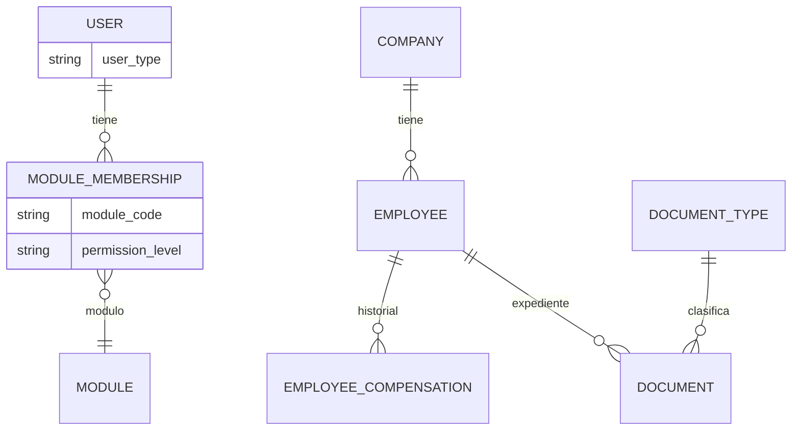

# DBPI — Especificaciones de la aplicación

**DBPI** — Dynacom Business Process Integration

> Documento vivo: se actualiza conforme avance el desarrollo.  
> **Última revisión:** 2025-11-26  
> **Stack:** Laravel 12 + Filament 5 (panel `/admin`)

---

## 1. Visión general

Aplicación modular para operación interna de negocio. Los módulos comparten datos y flujos donde tenga sentido (empleados, empresas, clientes, tickets, etc.) sin duplicar información ni romper el aislamiento por contexto de cada área.

### 1.1 Módulos

| Módulo | Código interno | Estado | Prioridad |
|--------|----------------|--------|-----------|
| Usuarios y acceso | `core` | **En desarrollo (fase 0)** | Alta |
| Recursos Humanos | `rh` | Pendiente (tras `core`) | Alta |
| Comercial | `comercial` | Pendiente | — |
| Helpdesk | `helpdesk` | Pendiente | — |
| CRM | `crm` | Pendiente | — |

### 1.2 Principios transversales

- **Idioma:** la aplicación completa debe estar en **español** (interfaz del panel, etiquetas, mensajes de validación, notificaciones, correos y textos orientados al usuario). Código, nombres de variables y comentarios técnicos pueden permanecer en inglés según convención Laravel.
- **Multi-empresa:** varias empresas (razones sociales / unidades de negocio) en el mismo sistema.
- **Modularidad:** cada módulo con recursos Filament y modelos propios; relaciones explícitas entre módulos cuando se implementen integraciones.
- **Documentos genéricos:** almacenamiento de archivos asociados a entidades (empleado, empresa, etc.) con tipo/categoría configurable, no hardcodeado a un solo tipo de archivo.
- **Auditoría (futuro):** registrar quién y cuándo modifica datos sensibles (sueldos, documentos).
- **Autenticación única:** una cuenta de usuario en el sistema; el **tipo** de cuenta y las **membresías por módulo** definen qué puede hacer cada persona (ver §2).

---

## 2. Módulo: Usuarios y acceso (`core`)

> Base del sistema. Debe implementarse **antes** de los módulos de negocio (RH, Comercial, etc.).

### 2.1 Objetivo

Gestionar cuentas de acceso, tipos de usuario, permisos (membresías) por módulo y operaciones CRUD autorizadas en el panel Filament.

### 2.2 Tipos de usuario (rol de alto nivel)

Todos los que inician sesión son **usuarios** a nivel técnico (modelo `User`). Además, cada cuenta tiene un **tipo** que define su comportamiento global:

| Tipo | Código | Descripción |
|------|--------|-------------|
| **Usuario** | `usuario` | Personal interno u operativo. Acceso limitado según membresías por módulo. |
| **Administrador** | `administrador` | Acceso a todos los módulos; gestión de usuarios, permisos y configuración transversal. |
| **Contacto** | `contacto` | Cuenta para personas ligadas a cuentas del CRM (cliente/externo). Alcance reducido y portal orientado a autoservicio (fase posterior). |

### 2.3 Usuario (`usuario`)

- Todos los tipos comparten el mismo mecanismo de login; la diferencia está en tipo + permisos.
- **Membresías por módulo:** cada usuario puede tener asignación en `rh`, `comercial`, `helpdesk`, `crm` (independiente por módulo).
- **Nivel de permiso por módulo** (propuesta mínima):

| Nivel | Código | Permite |
|-------|--------|---------|
| Sin acceso | — | No ve el módulo en el menú ni sus rutas. |
| Ver | `view` | Listar y consultar detalle. |
| Editar | `edit` | Crear y modificar (incluye `view`). |
| Eliminar | `delete` | Borrado lógico/físico según política del módulo (incluye `edit`). |

- Un mismo usuario puede tener, por ejemplo, `edit` en RH y solo `view` en Helpdesk.

### 2.4 Administrador (`administrador`)

- Acceso **completo** a todos los módulos actuales y futuros, sin depender de membresías individuales (o membresía implícita “todo permitido”).
- Puede crear, editar y desactivar **usuarios** y asignar membresías a otros.
- **Regla de negocio:** un administrador **no puede eliminarse a sí mismo** (ni forzar borrado desde el panel). Otro administrador debe hacerlo, o solo desactivación por política (definir en implementación).

### 2.5 Contacto (`contacto`)

**Estado:** diseño documentado; **implementación funcional pendiente** hasta existir CRM y Helpdesk.

- Se asociará a **contactos de cuentas** del módulo CRM (relación `contact` ↔ `user` por definir).
- Objetivo: que el contacto pueda **ingresar** para:
  - Consultar **sus propios datos** vinculados a la cuenta.
  - **Levantar tickets** de atención en Helpdesk (solicitante externo).
- Probablemente **no** accede al panel `/admin` completo en la misma UI que usuarios internos (panel o guard distinto — decisión abierta en §9.1).

### 2.6 Alcance fase 0 (construcción actual)

- [ ] Extender modelo `User` (tipo de usuario, activo, etc.).
- [ ] Membresías / permisos por módulo (`view` / `edit` / `delete`).
- [ ] Filament Resource (o equivalente) para gestión de usuarios (solo administradores).
- [ ] Policies / autorización en panel acorde a módulo y nivel.
- [ ] Validación: administrador no puede eliminarse a sí mismo.
- [ ] Reservar modelo/flujo para **contactos** sin implementar CRM aún (flags o tipo sin rutas).

### 2.7 Fuera de alcance fase 0

- Portal completo de contactos, SSO, 2FA obligatorio, recuperación de contraseña personalizada (usar flujo Filament/Laravel por defecto salvo que se pida).
- Sincronización automática contacto CRM ↔ usuario (cuando exista CRM).

### 2.8 Criterios de aceptación fase 0

- [ ] Administrador puede CRUD de usuarios (excepto auto-eliminación).
- [ ] Asignar tipo `usuario` | `administrador` | `contacto`.
- [ ] Asignar permisos por módulo a usuarios tipo `usuario`.
- [ ] Menú y acciones Filament respetan permisos (al menos en un módulo de prueba o globalmente preparado).
- [ ] Documentación y seeds de usuario administrador inicial.

---

## 3. Módulo: Recursos Humanos (`rh`)

### 3.1 Objetivo

Gestionar empresas registradas en el sistema, sus empleados, datos personales y laborales, compensación y expediente documental digital.

### 3.2 Alcance fase 1 (tras módulo usuarios)

- CRUD de **empresas** (catálogo maestro del módulo RH).
- CRUD de **empleados** vinculados a una empresa.
- Información **personal** del empleado.
- Información de **compensación / sueldo** (estructura base; detalle en §3.4).
- **Expediente documental** por empleado: subida, clasificación y consulta de archivos de cualquier tipo permitido (INE, estudio socioeconómico, constancia, contratos, etc.).

### 3.3 Fuera de alcance fase 1 (pendiente RH)

- Nómina, timbrado, INCAP, prestaciones calculadas.
- Organigrama, puestos y jerarquías.
- Asistencia, vacaciones y permisos.
- Portal del empleado (autoservicio).
- Firma electrónica de documentos.
- Integración con Comercial / CRM / Helpdesk (ver §7).

### 3.4 Entidades propuestas

#### Empresa (`companies` o equivalente)

| Campo / aspecto | Notas |
|---------------|--------|
| Razón social, nombre comercial | Obligatorios según negocio |
| RFC, régimen fiscal (opcional fase 1) | Útil para reportes futuros |
| Dirección, contacto | Opcional fase 1 |
| Activo / inactivo | Soft delete o flag `is_active` |

#### Empleado (`employees`)

| Campo / aspecto | Notas |
|---------------|--------|
| `company_id` | Pertenece a una empresa |
| Datos personales | Nombre(s), apellidos, CURP, RFC, NSS, fecha nacimiento, género, estado civil, contacto (email, teléfono), domicilio |
| Datos laborales | Fecha ingreso, fecha baja (nullable), número de empleado interno, estatus (activo, baja, suspendido) |
| Relación 1:N con documentos y con registros de sueldo |

#### Compensación (`employee_compensations` o campos en empleado — por definir en implementación)

| Campo / aspecto | Notas |
|---------------|--------|
| Sueldo base, periodicidad (mensual, quincenal, etc.) | Histórico recomendado (nueva fila al cambiar sueldo) |
| Moneda | Default MXN |
| Vigencia (`effective_from`, `effective_to`) | Para historial |
| Notas internas | No visibles en portal futuro sin permiso |

#### Tipo de documento (`document_types`) — catálogo genérico

| Campo / aspecto | Notas |
|---------------|--------|
| Nombre, código slug | Ej. `ine`, `estudio_socioeconomico`, `constancia` |
| Módulo / contexto | `rh` (extensible a otros módulos) |
| Requiere vencimiento | Opcional |
| Activo | Para ocultar tipos obsoletos sin borrar historial |

#### Documento (`documents` — polimórfico o `employee_documents` + diseño genérico)

| Campo / aspecto | Notas |
|---------------|--------|
| Entidad dueña | Empleado (fase 1); patrón polimórfico `documentable` para reutilizar en otros módulos |
| `document_type_id` | Clasificación |
| Archivo | Disco configurado (`local` / `s3` vía `config/filament.php`) |
| Nombre original, MIME, tamaño | Metadata |
| Fecha emisión / vencimiento | Opcional según tipo |
| Subido por (`user_id`) | Usuario del panel |
| Notas | Texto libre |

### 3.5 Reglas de negocio (borrador)

1. Un empleado pertenece a **una** empresa (fase 1). Reasignación entre empresas = caso especial (pendiente).
2. No eliminar físicamente documentos con valor legal; preferir **inactivar** o soft delete.
3. Tipos de documento administrables desde el panel (seed inicial con ejemplos: INE, Estudio socioeconómico, Constancia, CURP, comprobante domicilio, contrato).
4. Extensiones y tamaño máximo de archivo: definir en configuración (pendiente valores exactos).

### 3.6 UI Filament (fase 1)

- Grupo de navegación: **Recursos Humanos**
- Resources: Empresas, Empleados, Tipos de documento
- En empleado: pestañas o relation managers para **Compensación** y **Documentos** (upload + lista + descarga)
- Autorización según membresías del módulo `rh` (§2)

### 3.7 Criterios de aceptación fase 1

- [ ] Crear/editar/listar empresas
- [ ] Crear/editar/listar empleados por empresa
- [ ] Registrar y consultar historial de sueldo (al menos un registro vigente)
- [ ] Subir documento con tipo seleccionable y descargar desde el panel
- [ ] Seed de tipos de documento RH de ejemplo

---

## 4. Módulo: Comercial — *Pendiente*

> Placeholder hasta definir alcance.

**Ideas iniciales (sin compromiso):**

- Catálogo de productos/servicios, cotizaciones, órdenes.
- Vinculación futura con empresas/clientes del CRM.

**Dependencias RH:** ninguna obligatoria en fase 1.

---

## 5. Módulo: Helpdesk — *Pendiente*

> Placeholder hasta definir alcance.

**Ideas iniciales (sin compromiso):**

- Tickets, categorías, SLA, asignación a usuarios/agentes.
- Solicitantes: usuarios internos o **contactos** con cuenta (§2.5).

---

## 6. Módulo: CRM — *Pendiente*

> Placeholder hasta definir alcance.

**Ideas iniciales (sin compromiso):**

- Prospectos, clientes, oportunidades, actividades.
- Cuentas y **contactos**; los contactos podrán tener usuario tipo `contacto` (§2.5).
- Posible uso de la misma entidad **Empresa** o modelo `Account` compartido (decisión pendiente para evitar duplicar razones sociales).

---

## 7. Integración entre módulos — *Pendiente*

| Integración | Descripción | Estado |
|-------------|-------------|--------|
| RH ↔ CRM | Empresa cliente vs empresa empleadora | Por definir |
| RH ↔ Helpdesk | Empleado como usuario solicitante | Por definir |
| CRM ↔ Contactos ↔ `core` | Usuario tipo contacto ligado a contacto CRM | Por definir (§2.5) |
| Contactos ↔ Helpdesk | Tickets desde portal de contacto | Por definir (§2.5) |
| Comercial ↔ CRM | Cotización → oportunidad | Por definir |

---

## 8. Modelo de datos (diagrama conceptual)

---

## 9. Decisiones técnicas

| Tema | Decisión | Fecha |
|------|----------|-------|
| Idioma de la aplicación | Español (`APP_LOCALE=es`). Filament 5 trae `lang/es` en sus paquetes y usa `app()->getLocale()`; no requiere `->locale()` en el panel | 2025-11-25 |
| Panel admin | Filament 5, ruta `/admin` | 2025-11-25 |
| BD inicial | SQLite (desarrollo) | 2025-11-25 |
| Documentos | Catálogo `document_types` + almacenamiento en disco Laravel | 2025-11-25 |
| Polimorfismo documentos | Recomendado para reuso inter-módulos | 2025-11-25 (propuesta) |

### 9.1 Decisiones abiertas

- [ ] ¿Una sola tabla `companies` global o `rh_companies` separada de cuentas CRM?
- [ ] ¿Membresías en tablas propias vs paquete (p. ej. Spatie Permission) vs Filament Shield?
- [ ] Panel y guard para **contactos**: mismo `/admin` con menú vacío reducido vs panel `portal` separado.
- [ ] Disco de producción para documentos (S3, local cifrado, etc.)
- [ ] Campos obligatorios legales por empleado (CURP, RFC, NSS)

---

## 10. Historial de cambios

| Fecha | Cambio |
|-------|--------|
| 2025-11-25 | Creación del documento. Módulo RH definido para fase 1; demás módulos en pendiente. |
| 2025-11-25 | Requisito de idioma: aplicación completa en español. |
| 2025-11-25 | Panel Filament en español vía `APP_LOCALE=es` (Laravel). |
| 2025-11-26 | §2 Usuarios y acceso: tipos Usuario, Administrador y Contacto; membresías por módulo; orden de desarrollo (core antes que RH). |

---

## 11. Próximos pasos de desarrollo

1. **Módulo usuarios (`core`):** modelo, tipos, membresías por módulo, Resource Filament, regla anti auto-eliminación del administrador.
2. Migraciones y modelos RH: Empresa, Empleado, Compensación, TipoDocumento, Documento.
3. Filament Resources RH (documentos, sueldo) con políticas ligadas a §2.
4. Revisar decisiones abiertas (§9.1).