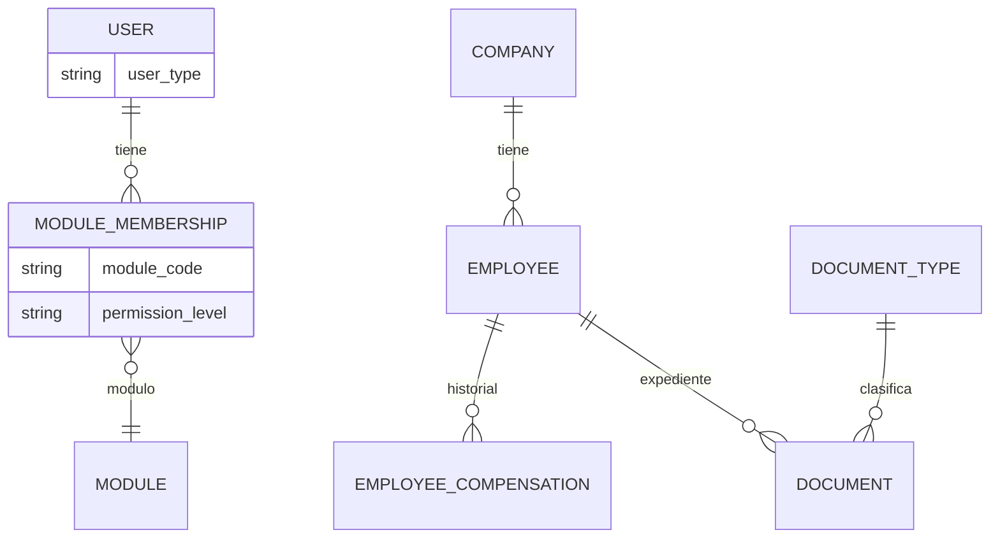

# DBPI — Especificaciones de la aplicación

**DBPI** — Dynacom Business Process Integration

> Documento vivo: se actualiza conforme avance el desarrollo.  
> **Última revisión:** 2026-11-26  
> **Stack:** Laravel 12 + Filament 5 (panel `/admin`)

---

## 1. Visión general

Aplicación modular para operación interna de negocio. Los módulos comparten datos y flujos donde tenga sentido (empleados, empresas, clientes, tickets, etc.) sin duplicar información ni romper el aislamiento por contexto de cada área.

### 1.1 Módulos

| Módulo | Código interno | Estado | Prioridad |
|--------|----------------|--------|-----------|
| Usuarios y acceso | `core` | **Fase 0 operativa** | Alta |
| Recursos Humanos | `rh` | **Fase 1 operativa (en pausa)** | Alta |
| Comercial | `comercial` | Pendiente | — |
| Helpdesk | `helpdesk` | Pendiente | — |
| CRM | `crm` | **Siguiente en desarrollo** | Alta |

### 1.2 Principios transversales

- **Idioma:** la aplicación completa debe estar en **español** (interfaz del panel, etiquetas, mensajes de validación, notificaciones, correos y textos orientados al usuario). Código, nombres de variables y comentarios técnicos pueden permanecer en inglés según convención Laravel.
- **Multi-empresa:** varias empresas (razones sociales / unidades de negocio) en el mismo sistema.
- **Modularidad:** cada módulo con recursos Filament y modelos propios; relaciones explícitas entre módulos cuando se implementen integraciones.
- **Documentos genéricos:** almacenamiento de archivos asociados a entidades (empleado, empresa, etc.) con tipo/categoría configurable, no hardcodeado a un solo tipo de archivo.
- **Auditoría (futuro):** registrar quién y cuándo modifica datos sensibles (sueldos, documentos).
- **Autenticación única:** una cuenta de usuario en el sistema; el **tipo** de cuenta y las **membresías por módulo** definen qué puede hacer cada persona (ver §2).

---

## 2. Módulo: Usuarios y acceso (`core`)

> Base del sistema. Debe implementarse **antes** de los módulos de negocio (RH, Comercial, etc.).

### 2.1 Objetivo

Gestionar cuentas de acceso, tipos de usuario, permisos (membresías) por módulo y operaciones CRUD autorizadas en el panel Filament.

### 2.2 Tipos de usuario (rol de alto nivel)

Todos los que inician sesión son **usuarios** a nivel técnico (modelo `User`). Además, cada cuenta tiene un **tipo** que define su comportamiento global:

| Tipo | Código | Descripción |
|------|--------|-------------|
| **Usuario** | `usuario` | Personal interno u operativo. Acceso limitado según membresías por módulo. |
| **Administrador** | `administrador` | Acceso a todos los módulos; gestión de usuarios, permisos y configuración transversal. |
| **Contacto** | `contacto` | Cuenta para personas ligadas a cuentas del CRM (cliente/externo). Alcance reducido y portal orientado a autoservicio (fase posterior). |

### 2.3 Usuario (`usuario`)

- Todos los tipos comparten el mismo mecanismo de login; la diferencia está en tipo + permisos.
- **Membresías por módulo:** cada usuario puede tener asignación en `rh`, `comercial`, `helpdesk`, `crm` (independiente por módulo).
- **Nivel de permiso por módulo** (propuesta mínima):

| Nivel | Código | Permite |
|-------|--------|---------|
| Sin acceso | — | No ve el módulo en el menú ni sus rutas. |
| Ver | `view` | Listar y consultar detalle. |
| Editar | `edit` | Crear y modificar (incluye `view`). |
| Eliminar | `delete` | Borrado lógico/físico según política del módulo (incluye `edit`). |

- Un mismo usuario puede tener, por ejemplo, `edit` en RH y solo `view` en Helpdesk.

### 2.4 Administrador (`administrador`)

- Acceso **completo** a todos los módulos actuales y futuros, sin depender de membresías individuales (o membresía implícita “todo permitido”).
- Puede crear, editar y desactivar **usuarios** y asignar membresías a otros.
- **Regla de negocio:** un administrador **no puede eliminarse a sí mismo** (ni forzar borrado desde el panel). Otro administrador debe hacerlo, o solo desactivación por política (definir en implementación).

### 2.5 Contacto (`contacto`)

**Estado:** diseño documentado; **implementación funcional pendiente** hasta existir CRM y Helpdesk.

- Se asociará a **contactos de cuentas** del módulo CRM (relación `contact` ↔ `user` por definir).
- Objetivo: que el contacto pueda **ingresar** para:
  - Consultar **sus propios datos** vinculados a la cuenta.
  - **Levantar tickets** de atención en Helpdesk (solicitante externo).
- Probablemente **no** accede al panel `/admin` completo en la misma UI que usuarios internos (panel o guard distinto — decisión abierta en §9.1).

### 2.6 Alcance fase 0 (construcción actual)

- [x] Extender modelo `User` (`user_type`, `is_active`, etc.).
- [x] Membresías por módulo (`module_memberships`: `view` / `edit` / `delete`) vía enum `AppModule`.
- [x] Resource Filament **Usuarios** (administradores y flujo según políticas).
- [x] Autorización en RH: políticas `Company` / `Employee`, membresía `rh` y asignación **empresa ↔ usuario** (`company_user`).
- [ ] Validación explícita: administrador no puede eliminarse a sí mismo (revisar / endurecer en UI).
- [x] Tipo `contacto` reservado en enum; sin rutas funcionales hasta CRM.

### 2.7 Fuera de alcance fase 0

- Portal completo de contactos, SSO, 2FA obligatorio, recuperación de contraseña personalizada (usar flujo Filament/Laravel por defecto salvo que se pida).
- Sincronización automática contacto CRM ↔ usuario (cuando exista CRM).

### 2.8 Criterios de aceptación fase 0

- [x] Administrador puede CRUD de usuarios.
- [x] Asignar tipo `usuario` | `administrador` | `contacto`.
- [x] Asignar permisos por módulo a usuarios tipo `usuario`.
- [x] Menú y acciones Filament respetan permisos en módulo **RH** (y placeholders en otros módulos).
- [ ] Documentación y seeds de usuario administrador inicial (definir seed estándar en despliegue).

---

## 3. Módulo: Recursos Humanos (`rh`)

> **Estado (2026-11-26):** fase 1 **implementada y dada por cerrada por ahora**. Mejoras futuras (catálogo genérico de tipos de documento, historial de sueldo, etc.) quedan en §3.3.

### 3.1 Objetivo

Gestionar empresas registradas en el sistema, sus empleados, datos personales y laborales, compensación y expediente documental digital.

### 3.2 Implementado en fase 1

| Área | Qué hay en el panel |
|------|---------------------|
| **Empresas** | CRUD `CompanyResource`; relation managers **Sucursales**, **Departamentos**, **Puestos** |
| **Empleados** | Entrada por empresa (`BrowseCompanies` → listado); alta rápida y edición completa |
| **Ficha empleado** | Pestañas: personal (fotos), salario, puesto y ubicación, banco, IMSS, vacaciones, adjuntos |
| **Catálogos por empresa** | Sucursal, departamento, puesto (select con alta rápida en empleado) |
| **Fotos** | Hasta 3; rejilla tipo Drive; edición de imagen; reordenar |
| **Expediente digital** | Adjuntos por empleado (`employee_attachments`); rejilla tipo Drive; nombre, fecha, renombrar / eliminar |
| **Acceso** | Usuario `usuario` con permiso `rh` solo ve **empresas asignadas** en `company_user` |
| **Almacenamiento** | Disco `public`; rutas `employees/{id}/photos` y `employees/{id}/attachments` |

### 3.3 Fuera de alcance / pendiente RH (no bloquea otros módulos)

- Nómina, timbrado, INCAP, prestaciones calculadas.
- Organigrama y **jerarquías** (el catálogo de **puestos** por empresa sí está; no hay árbol de reportes).
- **Historial de compensación** (tabla `employee_compensations`); hoy sueldo en campos del empleado.
- **Catálogo genérico** `document_types` y modelo polimórfico `documents` (hoy adjuntos con `title` libre).
- Asistencia y workflow formal de permisos (vacaciones: campos informativos básicos).
- Portal del empleado (autoservicio).
- Firma electrónica de documentos.
- Integración con Comercial / CRM / Helpdesk (ver §7).

### 3.4 Entidades (implementadas y propuestas)

#### Empresa (`companies` o equivalente)

| Campo / aspecto | Notas |
|---------------|--------|
| Razón social, nombre comercial | Obligatorios según negocio |
| RFC, régimen fiscal (opcional fase 1) | Útil para reportes futuros |
| Dirección, contacto | Opcional fase 1 |
| Activo / inactivo | Soft delete o flag `is_active` |

#### Catálogos por empresa (implementados)

| Tabla | Uso |
|-------|-----|
| `company_branches` | Sucursales |
| `company_departments` | Departamentos |
| `company_positions` | Puestos reutilizables en empleados |

#### Empleado (`employees`)

| Campo / aspecto | Notas |
|---------------|--------|
| `company_id` | Pertenece a una empresa |
| Datos personales | Nombre(s), apellidos, CURP, RFC, NSS, fecha nacimiento, género, estado civil, contacto, domicilio |
| Datos laborales | Número de empleado, `company_position_id`, sucursal, departamento, estatus, fechas ingreso / baja |
| Compensación (en empleado) | `monthly_salary`, `salary_currency` |
| Banco / IMSS / vacaciones | Campos dedicados en la ficha (sin nómina) |
| Relaciones | `employee_photos`, `employee_attachments` |

#### Foto (`employee_photos`)

| Campo / aspecto | Notas |
|---------------|--------|
| `path`, `sort_order` | Máx. 3 por empleado en UI |

#### Adjunto (`employee_attachments`)

| Campo / aspecto | Notas |
|---------------|--------|
| `title`, `file_path`, `original_name` | Nombre visible y archivo en disco |
| `mime_type`, `file_size`, `uploaded_by`, `notes` | Metadata y auditoría básica |

#### Compensación con historial (`employee_compensations`) — *propuesto, no implementado*

| Campo / aspecto | Notas |
|---------------|--------|
| Sueldo, periodicidad, vigencia | Histórico al cambiar sueldo (futuro) |

#### Tipo de documento (`document_types`) y `documents` polimórfico — *propuesto, no implementado*

Sustituido en fase 1 práctica por adjuntos con título libre; conviene alinear con CRM u otros módulos en una iteración posterior.

### 3.5 Reglas de negocio (borrador)

1. Un empleado pertenece a **una** empresa (fase 1). Reasignación entre empresas = caso especial (pendiente).
2. No eliminar físicamente documentos con valor legal; preferir **inactivar** o soft delete.
3. Tipos de documento administrables desde el panel (seed inicial con ejemplos: INE, Estudio socioeconómico, Constancia, CURP, comprobante domicilio, contrato).
4. Extensiones y tamaño máximo de archivo: definir en configuración (pendiente valores exactos).

### 3.6 UI Filament (fase 1)

- Grupo de navegación: **Recursos Humanos**
- Resources: **Empresas**, **Empleados** (por empresa asignada)
- Empresa: relation managers Sucursales, Departamentos, Puestos
- Empleado: formulario por pestañas (sin resource de tipos de documento)
- Autorización: `CompanyPolicy`, `EmployeePolicy`, `company_user`, `ModuleMembership` (`rh`)

### 3.7 Criterios de aceptación fase 1

- [x] Crear/editar/listar empresas
- [x] Crear/editar/listar empleados por empresa
- [x] Sueldo base en ficha (sin historial)
- [x] Subir fotos y adjuntos; consultar / descargar desde el panel
- [ ] Seed de tipos de documento RH (no aplica hasta catálogo genérico)

---

## 4. Módulo: Comercial — *Pendiente*

> Placeholder hasta definir alcance.

**Ideas iniciales (sin compromiso):**

- Catálogo de productos/servicios, cotizaciones, órdenes.
- Vinculación futura con empresas/clientes del CRM.

**Dependencias RH:** ninguna obligatoria en fase 1.

---

## 5. Módulo: Helpdesk — *Pendiente*

> Placeholder hasta definir alcance.

**Ideas iniciales (sin compromiso):**

- Tickets, categorías, SLA, asignación a usuarios/agentes.
- Solicitantes: usuarios internos o **contactos** con cuenta (§2.5).

---

## 6. Módulo: CRM (`crm`)

> **Estado (2026-11-26):** siguiente foco de desarrollo. En el panel existe página de módulo (`CrmModuleOverview`); sin entidades ni resources aún.

### 6.1 Objetivo

Gestionar **cuentas** (clientes / prospectos), **contactos**, oportunidades y actividades comerciales, como base para Comercial y Helpdesk.

### 6.2 Alcance fase 1 propuesto (CRM)

| Entidad (borrador) | Descripción |
|--------------------|-------------|
| **Cuenta** (`crm_accounts` o similar) | Cliente o prospecto: razón social, nombre comercial, RFC opcional, estatus, asignado a usuario interno |
| **Contacto** (`crm_contacts`) | Personas ligadas a una cuenta; email, teléfono; flags para usuario portal futuro |
| **Actividad** (`crm_activities`) | Llamadas, reuniones, notas con fecha y responsable (mínimo viable) |

**Opcional en fase 1** (según prioridad): pipeline de **oportunidades** (`crm_opportunities`) con etapas simples.

### 6.3 Reglas y decisiones CRM (a cerrar al iniciar)

1. **Empresa RH vs cuenta CRM:** hoy `companies` es catálogo **empleador** en RH. Las cuentas CRM serán modelo **separado** salvo decisión explícita en §9.1 (evitar mezclar empleador con cliente).
2. **Permisos:** reutilizar `module_memberships` con `AppModule::Crm` (`view` / `edit` / `delete`).
3. **Usuario tipo `contacto`:** definir en fase 1 solo el modelo de contacto; enlace `contact` ↔ `user` cuando exista portal o tickets (§2.5).
4. **Idioma y UI:** grupo de navegación **CRM**; resources Filament en español.

### 6.4 Fuera de alcance fase 1 CRM

- Campañas de marketing, email masivo, integración telefonía.
- Portal completo del contacto y tickets (Helpdesk).
- Sincronización automática con Comercial.

### 6.5 Criterios de aceptación fase 1 CRM

- [ ] CRUD de cuentas y contactos con relación cuenta ↔ contactos
- [ ] Registro de actividades por cuenta o contacto
- [ ] Menú y políticas según membresía `crm`
- [ ] Página resumen del módulo enlazada a resources reales (sustituir placeholder)

---

## 7. Integración entre módulos — *Pendiente*

| Integración | Descripción | Estado |
|-------------|-------------|--------|
| RH ↔ CRM | Empresa cliente vs empresa empleadora | Por definir |
| RH ↔ Helpdesk | Empleado como usuario solicitante | Por definir |
| CRM ↔ Contactos ↔ `core` | Usuario tipo contacto ligado a contacto CRM | Por definir (§2.5) |
| Contactos ↔ Helpdesk | Tickets desde portal de contacto | Por definir (§2.5) |
| Comercial ↔ CRM | Cotización → oportunidad | Por definir |

---

## 8. Modelo de datos (diagrama conceptual)

---

## 9. Decisiones técnicas

| Tema | Decisión | Fecha |
|------|----------|-------|
| Idioma de la aplicación | Español (`APP_LOCALE=es`). Filament 5 trae `lang/es` en sus paquetes y usa `app()->getLocale()`; no requiere `->locale()` en el panel | 2025-11-25 |
| Panel admin | Filament 5, ruta `/admin` | 2025-11-25 |
| BD inicial | SQLite (desarrollo) | 2025-11-25 |
| Documentos | Catálogo `document_types` + almacenamiento en disco Laravel | 2025-11-25 |
| Polimorfismo documentos | Recomendado para reuso inter-módulos | 2025-11-25 (propuesta) |

### 9.1 Decisiones abiertas

- [ ] ¿Una sola tabla `companies` global o `rh_companies` separada de cuentas CRM?
- [ ] ¿Membresías en tablas propias vs paquete (p. ej. Spatie Permission) vs Filament Shield?
- [ ] Panel y guard para **contactos**: mismo `/admin` con menú vacío reducido vs panel `portal` separado.
- [ ] Disco de producción para documentos (S3, local cifrado, etc.)
- [ ] Campos obligatorios legales por empleado (CURP, RFC, NSS)

---

## 10. Historial de cambios

| Fecha | Cambio |
|-------|--------|
| 2025-11-25 | Creación del documento. Módulo RH definido para fase 1; demás módulos en pendiente. |
| 2025-11-25 | Requisito de idioma: aplicación completa en español. |
| 2025-11-25 | Panel Filament en español vía `APP_LOCALE=es` (Laravel). |
| 2025-11-26 | §2 Usuarios y acceso: tipos Usuario, Administrador y Contacto; membresías por módulo; orden de desarrollo (core antes que RH). |
| 2026-11-26 | RH fase 1 documentada como operativa (empresas, empleados, catálogos, expediente digital). Siguiente módulo: **CRM** (§6 ampliado). |

---

## 11. Próximos pasos de desarrollo

1. **CRM fase 1:** migraciones y modelos (cuenta, contacto, actividad); policies; Resources Filament; permisos `crm` en usuarios (ya soportado en formulario de usuario).
2. Cerrar decisiones §9.1 aplicables al CRM (modelo de cuenta vs `companies` de RH).
3. **RH (cuando retome):** historial de sueldo, `document_types` genérico, seeds, regla anti auto-eliminación admin.
4. Helpdesk / Comercial: después de CRM mínimo y definición de contactos.